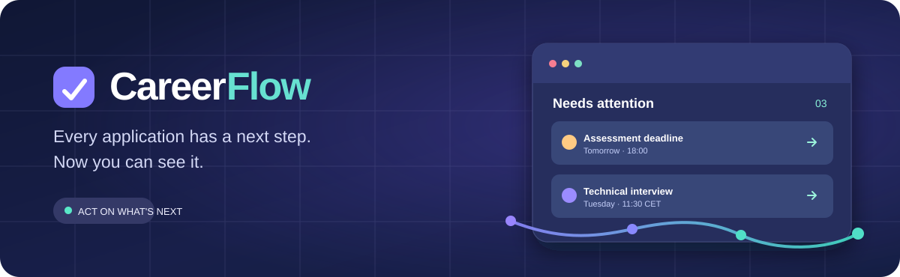
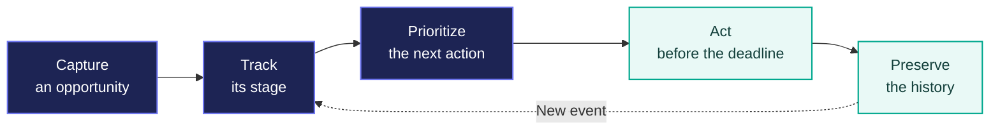
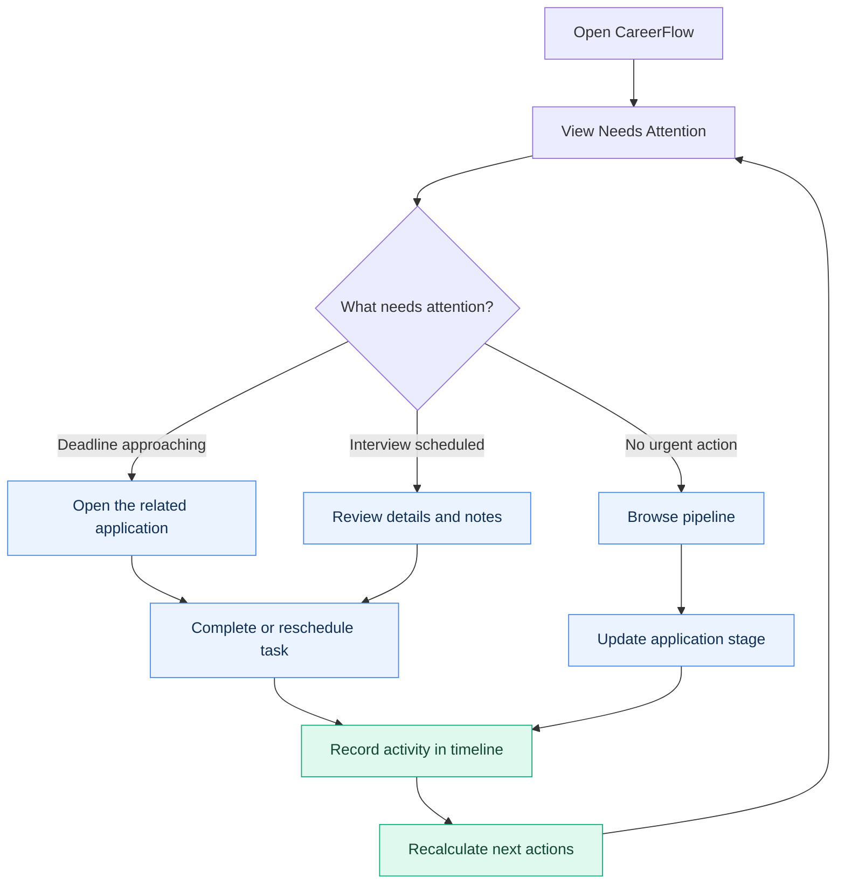
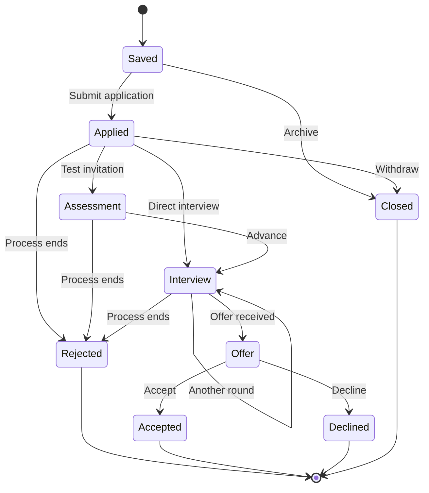
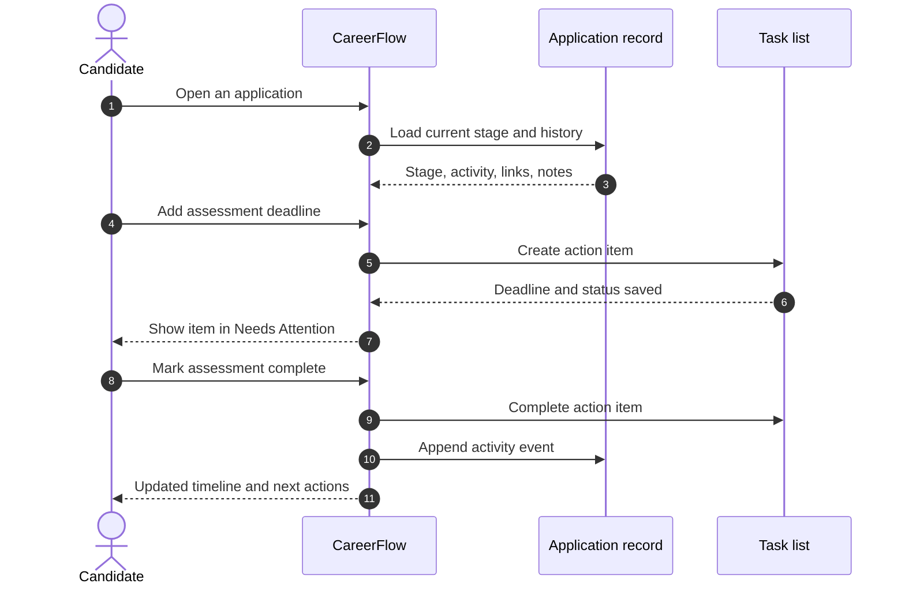
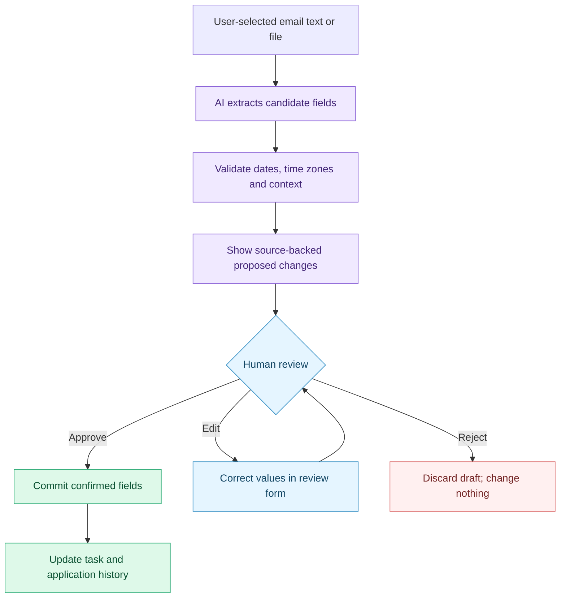
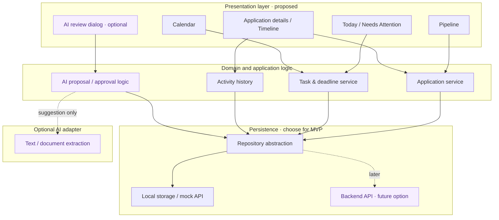
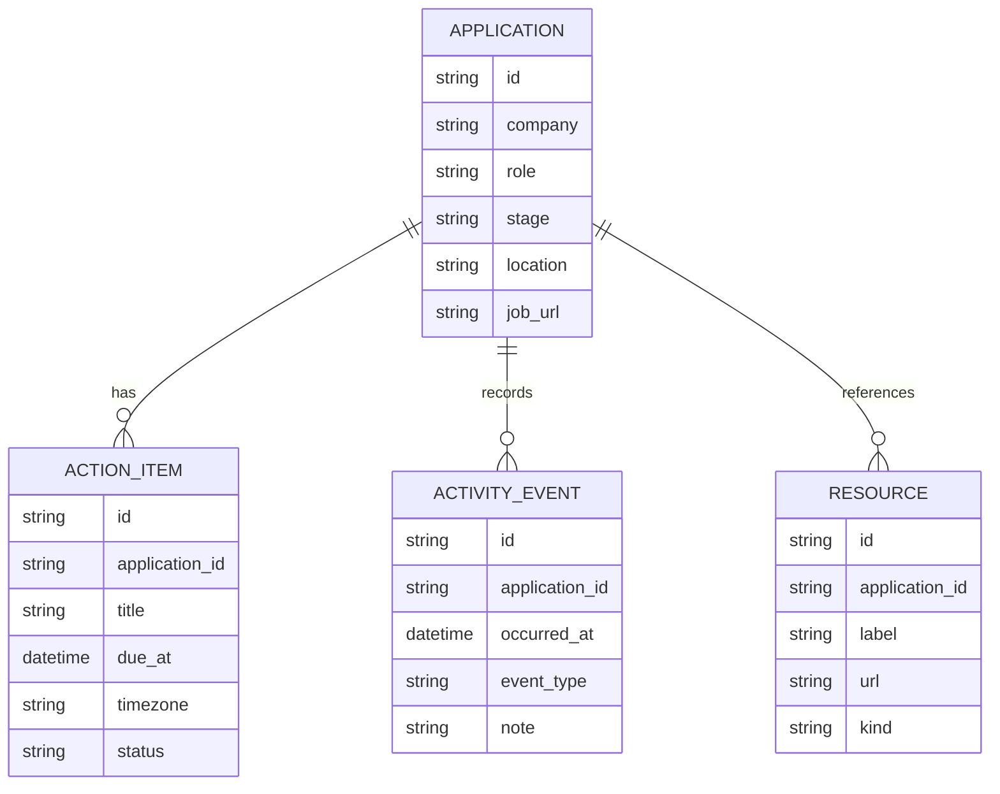
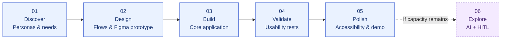

<p align="center">
  
</p>

<p align="center">
  <a href="#the-problem">The problem</a> ·
  <a href="#the-experience">The experience</a> ·
  <a href="#product-flows">Product flows</a> ·
  <a href="#ai-with-human-in-the-loop">AI + HITL</a> ·
  <a href="#architecture-proposal">Architecture</a> ·
  <a href="#roadmap">Roadmap</a>
</p>

<p align="center">
  
  
  
</p>

<h1 align="center">CareerFlow</h1>
<p align="center"><strong>Every application has a next step. Now you can see it.</strong></p>
<p align="center">
  A candidate-first workspace for tracking job applications, preparing for interviews,
  and staying ahead of deadlines — without losing the details between emails, calendars, and spreadsheets.
</p>

> [!IMPORTANT]
> **Project status:** CareerFlow is currently presented here as a **product and UX concept with a proposed MVP**. The diagrams, screen layouts, architecture, and AI interactions below describe the intended experience; they are **not claims that these features are already implemented**.

---

## The problem

Searching for internships and graduate roles rarely means managing *one* application. It means dealing with overlapping hiring processes, assessments, recruiter replies, interviews in different time zones, and deadlines that live in different places.

Most trackers tell you **where you applied**. CareerFlow is designed to tell you **what you should do next**.

| The friction | CareerFlow's proposed answer |
| :-- | :-- |
| Application details are scattered across inboxes and tabs | One record per application, with links, notes, tasks, and history |
| Deadlines appear in different messages and time zones | A unified, timezone-aware list of upcoming actions |
| Pipeline spreadsheets become stale | An editable visual recruitment pipeline |
| Recruiter conversations are hard to reconstruct | A chronological activity timeline for each company |
| Manual updates take time | Optional AI-assisted extraction, **reviewed before saving** |

### The product promise

**Capture → Prioritize → Act → Remember.**



---

## Designed for real applicants

<table>
<tr>
<td width="50%" valign="top">

### 🎓 Alexandra — Internship applicant

A university student juggling several internship applications, coding assessments, and interview invitations.

**Needs:** A fast way to add an application, spot urgent deadlines, and get to the right assessment link.

**Key question:** *“What do I need to do today?”*

</td>
<td width="50%" valign="top">

### 💼 Andrei — Graduate job seeker

A recent graduate comparing junior opportunities across companies, locations, and hiring processes.

**Needs:** An accurate history of recruiter interactions, a clear interview schedule, and space for decision notes.

**Key question:** *“What happened last, and what happens next?”*

</td>
</tr>
</table>

These are **design personas**, not actual user accounts or research participants.

---

## The experience

### One workspace. Three complementary views.

| **01 — Today** | **02 — Pipeline** | **03 — Timeline** |
| :-- | :-- | :-- |
| Your action-first home screen | Your visual recruitment overview | Your record of what happened |
| Overdue items, upcoming assessments, interview preparation, follow-ups | Drag or move applications through hiring stages | Recruiter conversations, status changes, notes, links, and decisions |
| **Optimized for urgency** | **Optimized for overview** | **Optimized for context** |

### An illustrative first screen

*Conceptual wireframe — not a screenshot of a running application.*

```text
┌──────────────────────────────────────────────────────────────────────────┐
│  CAREERFLOW                                       + Add application      │
├────────────────┬─────────────────────────────────────────────────────────┤
│                │  Good morning. Here's what matters.                   │
│  ● Today       │                                                         │
│    Pipeline    │  03 Needs attention  ·  17 Active  ·  02 Interviews     │
│    Calendar    │                                                         │
│    Applications│  NEEDS ATTENTION                                        │
│                │  ┌─────────────────────────────────────────────────┐    │
│                │  │ Orbit Labs        Submit coding assessment     │    │
│                │  │ Backend Intern     Tomorrow · 18:00            │    │
│                │  └─────────────────────────────────────────────────┘    │
│                │  ┌─────────────────────────────────────────────────┐    │
│                │  │ Northstar         Prepare for technical round  │    │
│                │  │ SWE Graduate       Tuesday · 11:30 CET         │    │
│                │  └─────────────────────────────────────────────────┘    │
│                │                                                         │
│                │  UPCOMING                      PIPELINE SNAPSHOT        │
│                │  Thu · HR screen               Applied         7        │
│                │  Fri · Assessment              Assessment      4        │
│                │                                Interview       6        │
└────────────────┴─────────────────────────────────────────────────────────┘
```

### Interaction principles

- **Action-first, not spreadsheet-first.** The most relevant next step is easier to see than the full history.
- **Progressive disclosure.** A quick overview opens into detailed application information when needed.
- **Fast manual capture.** Company, role, URL, and stage are enough to create an application; the rest can come later.
- **Honest states.** Distinguish *recruitment stage* from *task status*. An application can be in `Interview` while its preparation task is still `To do`.
- **Clear time semantics.** Show event time zones, flag missing hours, and never silently invent a deadline.
- **User control by default.** Assistive AI can suggest changes; the candidate decides whether they are stored.

---

## Product flows

### 1. The candidate's daily loop



### 2. Recruitment pipeline — stages are not tasks



> A hiring *stage* describes where the application stands. An *action item* describes what the candidate must do. The two are deliberately modeled separately.

### 3. From recruiter update to completed task



---

## AI with Human-in-the-Loop

### Useful assistance. No silent edits.

The proposed AI feature is designed to reduce repetitive typing, **not** to take control of the job search.

A candidate could **paste a recruiter email** or **upload a selected document**. CareerFlow would suggest structured data — company, role, hiring stage, interview time, assessment deadline, and a possible next action. Before anything is saved, the candidate sees the **source, proposed changes, and editable fields**.



#### An example of the proposed review experience

| Field | Current value | AI suggestion | Candidate decision |
| :-- | :-- | :-- | :-- |
| Stage | Applied | Assessment | Approve / edit / reject |
| Next action | — | Complete coding test | Approve / edit / reject |
| Deadline | — | Fri, 17:00 CET | Approve / edit / reject |
| Source | — | Selected recruiter email | Inspect excerpt |

**The trust contract**

1. **Nothing is committed before confirmation.** Parsing is not permission to modify application data.
2. **Provenance stays visible.** The user can inspect where a suggested date or stage came from.
3. **Uncertainty is surfaced.** If an email says “Friday” without an unambiguous date or time zone, the system asks rather than guessing.
4. **Edits are reversible.** Application changes belong in an auditable timeline; undo is a product goal.
5. **External actions require separate approval.** Sending emails, scheduling on external calendars, or acting in third-party services are **not autonomous MVP features**.
6. **No inbox access is required for the initial AI concept.** User-selected text or a file is enough to test the interaction.

---

## Architecture proposal

A deliberately small architecture suits a two-person student project. A React UI with a repository/service layer and **local persistence or a mock API** is enough to validate the core experience. A backend or hosted database can be added when needed; external integrations are not prerequisites for the first usable version.



### Candidate domain model



> **Design proposal, not an existing database schema.** An AI extraction draft should remain separate from the saved application until the user approves it.

---

## MVP scope

The core product should remain useful even if the AI layer is never enabled.

| Capability | Priority | Proposed release |
| :-- | :--: | :-- |
| Add, edit, and archive job applications | **P0** | MVP |
| Recruitment stages and pipeline view | **P0** | MVP |
| Next action and due date per application | **P0** | MVP |
| Needs Attention dashboard | **P0** | MVP |
| Application detail view with activity timeline | **P0** | MVP |
| Interview and deadline overview | **P0** | MVP |
| Filters, notes, links, and timezone handling | **P1** | MVP if time allows |
| Paste text → AI suggestion → review → save | **P2** | Optional extension |
| Gmail/Outlook connection and inbox synchronization | **Later** | Post-MVP |
| Two-way calendar synchronization | **Later** | Post-MVP |
| Advanced analytics and offer comparison | **Later** | Post-MVP |

### Non-goals for the first release

No automatic job applications, autonomous recruiter messages, invisible AI database updates, scraping-dependent workflows, or complex email-account permissions. These add substantial reliability and privacy costs without being necessary to validate CareerFlow's core value.

---

## Roadmap

This is a **proposed delivery sequence** for a 13-week university project, not a completed milestone history.



<details>
<summary><strong>Suggested milestone checklist</strong></summary>

- [ ] Interview potential users; refine the two personas and user stories.
- [ ] Map navigation, information architecture, empty states, and error states.
- [ ] Build an interactive Figma prototype and run initial usability tests.
- [ ] Implement application records and manual add/edit flows.
- [ ] Implement pipeline, action items, and activity timeline.
- [ ] Implement urgency sorting and a compact calendar overview.
- [ ] Run task-based usability sessions and address the biggest issues.
- [ ] Improve keyboard support, responsive layouts, and validation messages.
- [ ] If feasible, prototype AI extraction with explicit approval and rejection.

</details>

---

## UX validation plan

Design decisions should be tested against observable behavior, not just visual preference.

| User task | Proposed success criterion |
| :-- | :-- |
| Add a new application | Candidate completes the flow in **≤ 60 seconds** |
| Find the most urgent pending task | Correct item identified in **≤ 10 seconds** |
| Update an application's stage | Completed in **≤ 3 interactions** |
| Recall the last recruiter interaction | Candidate locates the relevant timeline event without consulting email |
| Review an AI-generated change | Candidate can inspect, correct, approve, or discard it before any data is saved |

*These are design targets for future testing, **not measured product results**.*

### Accessibility and reliability considerations

- Clear text labels alongside color-coded stages; color alone must not communicate status.
- Keyboard navigation and visible focus states for critical actions.
- Legible countdowns and explicit time zones for deadlines.
- Useful empty, loading, error, and undo states.
- Mobile-friendly capture, with desktop-friendly multi-application views.
- Explicit consent and careful handling of recruitment emails and personal data.

---

## Development status & setup

CareerFlow is documented here as a **design-led product concept**. Once the repository contains an executable application, this section should describe the actual framework, prerequisites, installation commands, environment variables, and run/test scripts. No unverified setup commands are included here.

The architecture is intentionally flexible: **React is a proposed frontend option**, not a claim about the current codebase.

---

## Team

Built as a Human–Computer Interaction (IOC/HCI) university project by:

- **Rareș-Andrei Celescu**
- **Matei-Ovidiu Tudose**

**University POLITEHNICA of Bucharest · Faculty of Automatic Control and Computers · Group 342C4**

---

<p align="center">
  <strong>Less tracking. More progress.</strong><br/>
  <sub>CareerFlow — make the next move obvious.</sub>
</p>
